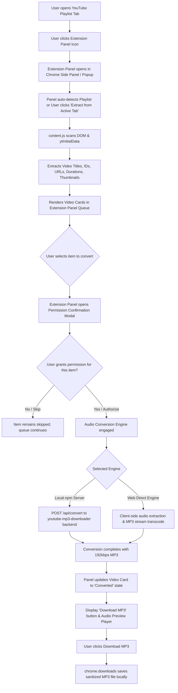

# YouTube Playlist to MP3 Converter (Chrome Extension)

A Google Chrome Extension (Manifest V3) that extracts video URLs from YouTube playlists and converts each video into MP3 audio with **explicit per-element permission verification** and direct download management — completely contained within the **Chrome Extension Panel**.

---

## 1. Features
- **Zero Page Clutter**: Operates strictly within the Chrome Extension Panel (Side Panel & Action Popup). Does not inject overlays, floating buttons, or DOM elements into YouTube.
- **Playlist Extraction**: Instantly extracts video titles, URLs, durations, thumbnails, and channel names from both playlist pages (`/playlist?list=...`) and playlist watch drawers (`/watch?v=...&list=...`).
- **Per-Element Permission Verification**: Every video item requires explicit user approval before audio conversion commences. Includes a Step-by-Step queue mode that prompts for permission on each element sequentially.
- **npm `youtube-mp3-downloader` Engine**: Ships with a ready-to-run Node.js companion server powered by the `youtube-mp3-downloader` npm package and `ffmpeg-static`.
- **Built-in Standalone Engine**: Includes a direct in-extension conversion engine so you can test and use the extension immediately even before launching the Node companion server.
- **One-Click MP3 Downloads**: Once converted, each video card provides a glowing "Download MP3" button and an inline audio preview player.

---

## 2. Processing Flow Diagram



---

## 3. Quickstart

### Step 1: Load the Extension into Google Chrome (< 1 minute)
1. Open Google Chrome and navigate to `chrome://extensions/`.
2. Toggle on **Developer mode** in the top-right corner.
3. Click the **Load unpacked** button in the top-left.
4. Select the project directory:
   ```
   c:\Users\johat.abrego\Documents\dev\downloaderParcher
   ```
5. Pin the extension to your Chrome toolbar.

### Step 2: (Optional) Run the Local npm Companion Server
The extension works immediately with its built-in engine. To use the exact `youtube-mp3-downloader` npm package backend:
```bash
cd server
npm install
npm start
```
The server will run on `http://localhost:4567`. The extension panel will automatically detect it and display a **🟢 Local npm Engine Ready** status badge.

---

## 4. Project Structure

```
downloaderParcher/
├── manifest.json                  # Manifest V3 specification
├── background.js                  # Service worker (downloads & sidepanel behavior)
├── content.js                     # Read-only YouTube DOM playlist extractor
├── sidepanel.html                 # Extension Panel UI
├── sidepanel.css                  # Modern dark-mode styling & micro-animations
├── sidepanel.js                   # Extension Panel controller & permission queue
│
├── server/                        # Companion Node.js backend
│   ├── package.json               # youtube-mp3-downloader, express, cors, ffmpeg-static
│   ├── server.js                  # Express API wrapping youtube-mp3-downloader
│   └── README.md                  # Server setup and usage instructions
│
├── docs/                          # Architecture & standards
│   ├── architecture.md            # Comprehensive technical design
│   └── diagrams/
│       ├── flow_diagram.mmd       # End-to-end processing flow
│       └── class_diagram.mmd      # UML class & component architecture
│
└── README.md                      # Primary project documentation
```

---

## 5. How to Use the Extension

1. **Open a Playlist on YouTube**:
   Navigate to any YouTube playlist (e.g. `https://www.youtube.com/playlist?list=PL...`).
2. **Open the Extension Panel**:
   Click the extension icon in your Chrome toolbar. Chrome will open the Extension Side Panel.
3. **Extract Videos**:
   Click **Extract from Active Tab**. The extension scans the page and populates the list of videos (Title, Duration, Thumbnail, Channel).
4. **Grant Permission per Element**:
   - **Individual Approval**: Click **Grant Permission & Convert** on any video card. An authorization modal will display video metadata and ask for confirmation.
   - **Step-by-Step Approval**: Click **Step-by-Step Convert** in the toolbar to iterate through each video in order, prompting for permission before each conversion.
5. **Download the MP3**:
   Once conversion reaches 100%, the card reveals a **Download MP3** button. Click it to save the `.mp3` file to your computer. You can also click **▶ Preview** to listen to the audio directly inside the panel.

---

## 6. Operational Notes & Known Limitations

- **Chrome Side Panel**: Supported on Chrome 116+. If the side panel is collapsed, clicking the extension icon also opens the view via action popup.
- **Permissions**: The extension uses `activeTab`, `scripting`, `downloads`, `storage`, and `sidePanel`. Host permissions are scoped to `youtube.com` and `localhost`.
- **YouTube DOM Updates**: If YouTube alters its playlist DOM classes, `content.js` features fallback selectors for `ytd-playlist-video-renderer`, `ytd-playlist-panel-video-renderer`, and `window.ytInitialData`.

---

## 7. License
MIT License. Built for personal, educational, and authorized audio extraction workflows.
