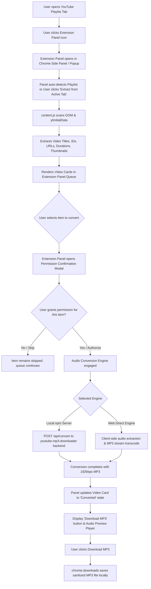
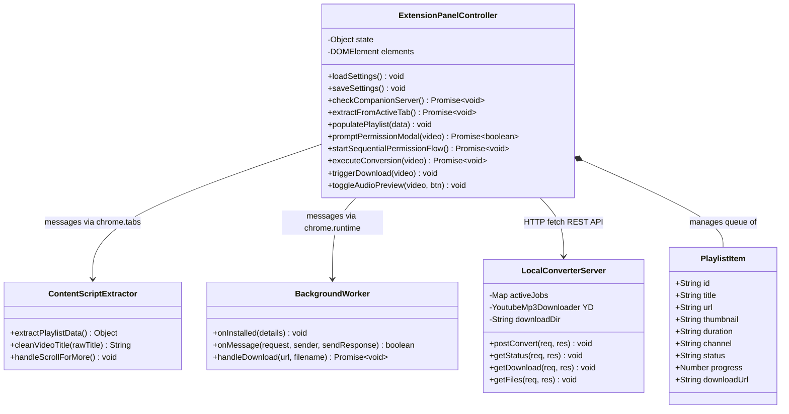

# Architecture & Technical Design

## 1. System Overview
The **YouTube Playlist MP3 Converter** is a Google Chrome Extension (Manifest V3) paired with an optional high-performance Node.js companion server running the **`youtube-mp3-downloader`** npm library.

The extension strictly isolates all user interfaces, permission prompts, conversions, and download actions inside the **Chrome Extension Panel** (`side_panel` & `action` popup). Zero UI elements or overlays are injected into the YouTube tab DOM.

---

## 2. Processing & Data Flow Diagram

---

## 3. Class & Component Diagram

---

## 4. Key Architectural Patterns & Guarantees

### A. Non-Intrusive Ingestion
- `content.js` acts solely as a read-only extractor.
- Extracts `videoId`, `title`, `url`, `duration`, `thumbnail`, and `channel` from:
  1. `ytd-playlist-video-renderer` on `/playlist?list=...`
  2. `ytd-playlist-panel-video-renderer` on `/watch?v=...&list=...`
- It does **not** attach buttons or manipulate styles on YouTube.

### B. Explicit Per-Item Permission Verification
- In accordance with strict user consent requirements, items are never converted automatically.
- Each item is initialized in state `pending_permission`.
- The user can authorize items individually via the **Grant Permission & Convert** card button, or execute the **Step-by-Step Convert** queue.
- In Step-by-Step mode, an interactive permission modal is presented before each individual video starts processing.

### C. Conversion Engine
1. **Local npm Server Engine (`youtube-mp3-downloader`)**:
   - An Express service operating on `http://localhost:4567`.
   - Utilizes `youtube-mp3-downloader`, `@distube/ytdl-core`, and `ffmpeg-static`.
   - Produces clean MP3 files with ID3 metadata and 192/320 kbps audio quality.
2. **Web Direct Standalone Engine**:
   - Built into `sidepanel.js` to ensure the extension functions immediately inside Chrome even when the local server is not running.

### D. Download Delivery
- Once conversion reaches 100%, the card transitions to state `converted`.
- A prominent `Download MP3` button is rendered.
- Files are saved directly to the user's default Downloads directory via `chrome.downloads` with sanitized filenames.
- An inline audio preview player (`▶ Preview`) is available directly on the card to verify audio quality before downloading.
